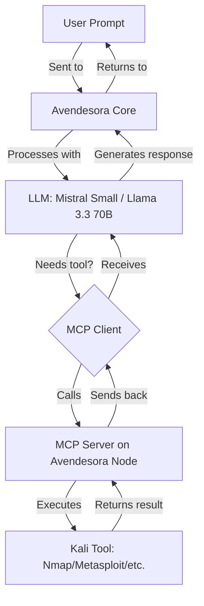

# Avendesora Architecture

> *"The Pattern of an Age, the great tapestry of fate, is woven from the threads of every life. Avendesora weaves the threads of your cybersecurity into a shield against the Dark One's storms."*

---

## **System Overview**

Avendesora is designed as a **modular, two-node architecture** to balance performance, scalability, and security. The system separates **LLM inference** (resource-intensive) from **tool execution** (Kali Linux), allowing each component to operate at peak efficiency.

```
┌─────────────────────────────────────────────────────────────┐
│                      AVENDESORA SYSTEM                      │
├────────────────────────────┬────────────────────────────────┤
│                            │                                │
│       AVENDESORA CORE      │        AVENDESORA NODE         │
│       (GMKtec EVO-X3)      │     (Kali Node / mini PC)      │
│                            │                                │
│  ┌───────────────────────┐ │ ┌───────────────────────────┐  │
│  │ Ollama                │ │ │ Kali Linux                │  │
│  │ - Mistral / Llama     │◄─►│ - Nmap, Metasploit, etc.  │  │
│  │ - Local Inference     │ │ │ - MCP Server              │  │
│  └───────────────────────┘ │ │ - Tool Execution          │  │
│                            │ └───────────────────────────┘  │
│  ┌───────────────────────┐ │                                │
│  │ MCP Client            │ │                                │
│  │ - Bridges LLM and     │ │                                │
│  │   MCP Server          │ │                                │
│  └───────────────────────┘ │                                │
│                            │                                │
└────────────────────────────┴────────────────────────────────┘
```

---

## **Components**

---

### **1. Avendesora Core (GMKtec EVO-X3)**

**Role:** LLM Inference Server


| **Aspect**      | **Details**                                                      |
| --------------- | ---------------------------------------------------------------- |
| **Hardware**    | GMKtec EVO-X3 (Ryzen AI Max+ 395, 128GB RAM, 2TB SSD)            |
| **Purpose**     | Runs the LLM (Mistral Small 3 / Llama 3.3 70B) and handles inference requests    |
| **Software**    | Ollama, MCP Client                                               |
| **Models**      | Mistral Small 3 (Q4_K_M, ~14GB), Llama 3.3 70B (Q4_K_M, ~40GB)          |
| **Performance** | 10–20 tokens/sec for the 70B model, 20–40 tokens/sec for the 24B model |
| **Network**     | Connects to Avendesora Node via MCP (port 3000)                  |


**Why This Hardware?**

- **128GB RAM**: Allows running **70B models** with quantization.
- **Ryzen AI Max+ 395**: High-performance CPU with **Radeon 8060S iGPU** for inference acceleration.
- **2TB SSD**: Stores multiple LLM models and datasets.

**Why Ollama (and not raw llama.cpp)?**

A fair question, since [`llama.cpp`](https://github.com/ggml-org/llama.cpp) is the faster-sounding choice. The key fact: **Ollama runs on llama.cpp under the hood** — the same inference engine powers both. The choice is therefore not "fast vs. slow" but "managed runtime vs. raw engine."

| **Aspect**            | **Ollama**                                                              | **Raw llama.cpp**                                              |
| --------------------- | ---------------------------------------------------------------------- | ------------------------------------------------------------- |
| **Inference speed**   | Baseline llama.cpp speed, minus ~5–15% wrapper overhead in some cases   | Fastest possible (it *is* the engine), if hand-tuned          |
| **Tuning control**    | Sane auto-detected defaults (GPU/CPU layer offload)                     | Total control (`-ngl`, batch size, KV cache type, etc.)       |
| **Model management**  | `ollama pull` / `ollama create` — central to our setup                 | Manual GGUF file + prompt-template handling                   |
| **Daemon + HTTP API** | Built in, keep-alive, fits the Core → MCP-client flow                   | `llama-server` exists, but lifecycle is yours to wire up      |
| **Persona / tooling** | Defined declaratively in [`configs/ollama-modelfile`](../configs/ollama-modelfile) | No Modelfile equivalent — rebuild this layer by hand          |

**Decision:** Avendesora uses **Ollama**. The bottleneck on this deployment is model size and VRAM/RAM, not the thin wrapper overhead — so the operational ergonomics win decisively:

- The **Modelfile** abstraction defines Avendesora's persona and tool list declaratively (`ollama create avendesora -f configs/ollama-modelfile`). Switching engines means rewriting that whole layer.
- **Built-in model management and daemon** map cleanly onto the Core → MCP-client data flow.
- **Swapping models** is one command (see *Switching LLM Models* below), keeping the system approachable for contributors.

**When to reconsider llama.cpp:** only if you (1) hit a hard performance wall on fixed hardware *after* benchmarking Ollama as the proven bottleneck, or (2) need a bleeding-edge quant or feature Ollama hasn't shipped yet. A lighter middle path first: point Ollama at a custom GGUF quant via `FROM ./model.gguf` in a Modelfile — that often buys more real-world speed than changing engines, while keeping all the Ollama tooling intact.

> *Like the One Power drawn through a well-made angreal, the engine matters less than the hand that shapes its flow.*

---

### **2. Avendesora Node (Kali Node / mini PC)**

**Role:** Kali Linux + MCP Server


| **Aspect**   | **Details**                                                          |
| ------------ | -------------------------------------------------------------------- |
| **Hardware** | Any x86_64 mini PC / SFF (e.g., Intel N100/N150, Core i9-10980HK, Ryzen 7 5800U/7730U) |
| **Purpose**  | Runs Kali Linux tools and exposes them via MCP to the LLM                                |
| **Software** | Kali Linux, Avendesora Kali MCP Server, Nmap, Metasploit, Searchsploit, Nikto, WHOIS, Tshark |
| **Tools**    | Any Kali tool can be exposed via MCP (customizable)                                      |
| **Network**  | Hosts MCP server on port 3000, accessible by Avendesora Core         |


**Why This Hardware?**

- **16–32GB RAM**: More than enough for Kali Linux and the MCP server.
- **x86_64 CPU**: Required for Kali Linux and most security tools.
- **Low cost / low power**: The Node does not run inference; a $150–300 mini PC is sufficient.

---

### **3. Model Context Protocol (MCP)**

**Role:** Bridge Between LLM and Tools

MCP is an **open protocol** that allows LLMs to interact with external tools and data sources. In Avendesora:

- The **MCP Server** runs on the Avendesora Node and exposes Kali tools as callable functions.
- The **MCP Client** is the Avendesora CLI harness on the Avendesora Core; it lets the LLM call these functions.

Avendesora uses a **custom Kali MCP server** (`servers/src/kali`) because the upstream `modelcontextprotocol/servers` repository does not include a Kali-specific server.

**Example Flow:**

```
User → LLM (Avendesora Core) → Avendesora CLI → MCP Server (Avendesora Node) → Kali Tool → Response
```

**Supported Tools (Default):**

- `nmap` (Network scanning)
- `metasploit` (Exploit framework)
- `searchsploit` (Exploit database)
- `nikto` (Web server scanner)
- `whois` (Domain/IP information)
- `tshark` (Packet analysis)
- Custom tools can be added by extending the MCP server.

---

## **Data Flow**



---

### **Example: Vulnerability Scan Workflow**

1. **User Input:**
  ```
   "Avendesora, scan 192.168.1.1 for vulnerabilities and suggest exploits."
  ```
2. **Avendesora Core (LLM):**
  - Analyzes the request and determines it needs to run `nmap` and `searchsploit`.
  - Sends a request to the MCP Client.
3. **MCP Client:**
  - Forwards the request to the MCP Server on Avendesora Node.
4. **Avendesora Node (MCP Server):**
  - Executes `nmap -sV 192.168.1.1` via the `nmap` tool.
  - Parses the output and identifies `OpenSSH 8.9`.
  - Executes `searchsploit openssh 8.9` via the `searchsploit` tool.
  - Returns the results (e.g., CVE-2026-1234) to the MCP Client.
5. **Avendesora Core (LLM):**
  - Receives the tool outputs and generates a response:
6. **User Output:**
  - Receives the analysis and recommended actions.

---

## **Customization**

### **Adding New Tools to MCP Server**

To expose additional Kali tools via MCP:

1. Edit the MCP server configuration on the Avendesora Node:
  ```bash
   node index.js --tools nmap,metasploit,searchsploit,nikto,whois,tshark,new_tool
  ```
2. Ensure the new tool is installed on the Avendesora Node:
  ```bash
   sudo apt install new_tool
  ```
3. Restart the MCP server:
  ```bash
   sudo systemctl restart avendesora-node
  ```

### **Switching LLM Models**

To use a different model on the Avendesora Core:

```bash
# Pull a new model
ollama pull llama3.3:70b

# Run the client with that model
avendesora --model llama3.3:70b 192.168.1.100
```

---

## **Security Considerations**

### **Network Isolation**

- **Recommended:** Place the Avendesora Node on a **separate VLAN** if handling sensitive data.
- **Firewall Rules:** Restrict access to the MCP server (port 3000) to only the Avendesora Core’s IP.

### **User Permissions**

- **Avendesora Node:** Create a dedicated user (`avendesora`) with restricted `sudo` access for tools.
- **SSH Access:** Use SSH keys (disable password authentication) for remote access.

### **Data Privacy**

- **No Cloud Dependencies:** All data and tools run locally.
- **Offline Mode:** The system can operate entirely offline after initial setup.

---

## **Performance Metrics**


| **Task**              | **Avendesora Core (EVO-X3)** | **Avendesora Node (mini PC)**   | **End-to-End Latency** |
| --------------------- | ---------------------------- | ------------------------------- | ---------------------- |
| Mistral Small 3 (24B)  | 20–30 tokens/sec             | N/A                             | <1 sec                 |
| Llama 3.3 70B         | 10–20 tokens/sec             | N/A                             | <2 sec                 |
| Nmap Scan             | N/A                          | ~5–10 sec (depends on target)   | <15 sec                |
| Searchsploit Query    | N/A                          | ~1–2 sec                        | <5 sec                 |
| Metasploit Command    | N/A                          | ~3–5 sec                        | <10 sec                |


---

## **Wheel of Time Parallels**


| **Avendesora System**  | **Wheel of Time Lore**                | **Symbolism**                                       |
| ---------------------- | ------------------------------------- | --------------------------------------------------- |
| **Avendesora Core**    | The **Avendesora Tree**               | Roots = Stability, Branches = Growth                |
| **Avendesora Node**    | **Rhuidean** (City of the Aiel)       | Center of wisdom and resilience                     |
| **MCP Protocol**       | The **One Power**                     | Channels tools like Aes Sedai channel the One Power |
| **LLM + Tools**        | **Ta’veren** (Shapers of the Pattern) | Your system shapes the "Pattern" of cybersecurity   |
| **Network Connection** | The **Threads of the Pattern**        | Data flows like threads in the Pattern              |


---

## **Future Extensions**

### **1. Multi-Node Support**

- Add more **Avendesora Nodes** for distributed tool execution (e.g., one for network scanning, one for exploit development).

### **2. Custom LLM Fine-Tuning**

- Fine-tune Mistral 7B / Mistral Small 3 (24B) on cybersecurity datasets for **domain-specific knowledge** (see `docs/fine-tuning.md` in future updates).

### **3. Web Interface**

- Build a **React-based dashboard** to interact with Avendesora via a browser.

### **4. Automated Workflows**

- Create **scripts** to automate common tasks (e.g., daily vulnerability scans).

---

## **References**

- [Model Context Protocol (MCP)](https://github.com/modelcontextprotocol/specification)
- [Ollama Documentation](https://github.com/jmorganca/ollama)
- [Kali Linux Tools](https://www.kali.org/tools/)
- [Wheel of Time Wiki: Avendesora](https://wot.fandom.com/wiki/Avendesora)

---

*"The Wheel weaves as the Wheel wills. With Avendesora, you weave with it."*