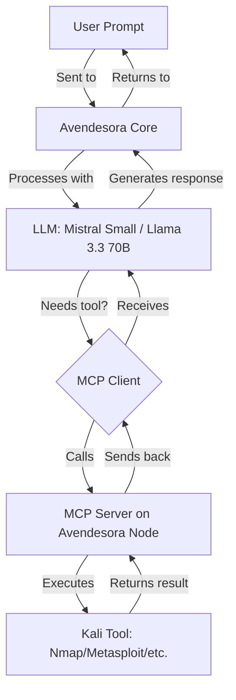

# Avendesora Architecture

> *"The Pattern of an Age, the great tapestry of fate, is woven from the threads of every life. Avendesora weaves the threads of your cybersecurity into a shield against the Dark One's storms."*

---

## **System Overview**

Avendesora is designed as a **modular, two-node architecture** to balance performance, scalability, and security. The system separates **LLM inference** (resource-intensive) from **tool execution** (Kali Linux), allowing each component to operate at peak efficiency.

```
┌─────────────────────────────────────────────────────────────┐
│                      AVENDESORA SYSTEM                      │
├────────────────────────────┬────────────────────────────────┤
│                            │                                │
│       AVENDESORA CORE      │        AVENDESORA NODE         │
│    (any 32GB+ Linux box)   │     (Kali Node / mini PC)      │
│                            │                                │
│  ┌───────────────────────┐ │ ┌───────────────────────────┐  │
│  │ Ollama                │ │ │ Kali Linux                │  │
│  │ - Mistral / Llama     │◄─►│ - Nmap, Metasploit, etc.  │  │
│  │ - Local Inference     │ │ │ - MCP Server              │  │
│  └───────────────────────┘ │ │ - Tool Execution          │  │
│                            │ └───────────────────────────┘  │
│  ┌───────────────────────┐ │                                │
│  │ MCP Client            │ │                                │
│  │ - Bridges LLM and     │ │                                │
│  │   MCP Server          │ │                                │
│  └───────────────────────┘ │                                │
│                            │                                │
└────────────────────────────┴────────────────────────────────┘
```

---

## **Components**

---

### **1. Avendesora Core**

**Role:** LLM Inference Server


| **Aspect**      | **Details**                                                      |
| --------------- | ---------------------------------------------------------------- |
| **Hardware**    | Any Linux or macOS machine with **32GB+ RAM** — see *Sizing the Core* below |
| **Purpose**     | Runs the LLM and handles inference requests                      |
| **Software**    | Ollama, Avendesora CLI (MCP client)                              |
| **Models**      | Mistral Small 3 (Q4_K_M, ~14GB) by default; larger models if the box has room |
| **Storage**     | ~50GB for one model and its tooling; more if you keep several around |
| **Network**     | Connects to Avendesora Node via MCP (port 3000)                  |


---

#### **Sizing the Core**

> *Start with the box you already own. Buy hardware only once a measurement tells
> you to.*

The single most useful thing to understand here: **RAM on the Core buys capacity —
which models fit — not speed.** Generation throughput is set by *memory bandwidth
divided by the bytes read per generated token*. Two machines with the same memory
bus run a 24B model at identical tokens/sec whether they hold 32GB or 128GB. The
larger pool only unlocks models the smaller one cannot load at all.

**What actually consumes the pool**

1. **Weights** — fixed per model and quantisation.
2. **KV cache** — grows linearly with context length. Security tool output is
   *extremely* verbose (full-port nmap XML, Nikto runs, tshark dumps), so on long
   agent sessions the cache, not the weights, is usually what runs you out of memory.

| Model                 | Weights (Q4_K_M) | KV cache/token (fp16) | KV @ 32k ctx | Comfortable Core RAM |
| --------------------- | ---------------- | --------------------- | ------------ | -------------------- |
| Mistral Small 3 (24B) | ~14GB            | ~160 KB               | ~5GB         | 32GB                 |
| Qwen3 32B             | ~20GB            | ~256 KB               | ~8GB         | 48–64GB              |
| Llama 3.3 70B         | ~40GB            | ~320 KB               | ~10GB        | 64GB (128GB at long context) |
| gpt-oss-120b (MoE)    | ~65GB (MXFP4)    | small (grouped attn)  | —            | 128GB                |

<sub>KV figures are computed from published layer/head geometry (2 × layers × KV-heads
× head-dim × 2 bytes) and assume fp16 cache; halve them with an 8-bit KV cache. Treat
them as planning estimates, not benchmarks.</sub>

**Three tiers, in the order you should consider them**

| Tier | Hardware | Model | What it gets you |
| ---- | -------- | ----- | ---------------- |
| **1 — Start here** | Any box with 32GB RAM, or a Mac with 32GB+ unified memory. Cost: likely **$0** | `mistral-small` (24B) | Everything this repo does today, plus enough headroom to build and test the agent loop |
| **2 — Comfortable** | 64GB desktop, 64GB unified-memory mini PC, or a 24GB discrete GPU (e.g. used RTX 3090) | `qwen3:32b`, or a 24B model *much* faster on the GPU | Longer contexts, a stronger tool-caller, snappier multi-step loops |
| **3 — Ceiling** | 128GB unified-memory APU (GMKtec EVO-X3, Framework Desktop, HP Z2 Mini G1a). Cost: **~$3,800** | `gpt-oss:120b` or `llama3.3:70b` | The most capable models that still run on one box you own outright |

Tier 3 is a genuinely good buy *for what it is* — around $4,000 it is close to the
best single-box local-inference machine you can get, and it is the tier the rest of
these docs treat as the aspirational target. It is **not** a prerequisite. Nothing in
Avendesora requires it.

**Dense vs. MoE: the reason 128GB is interesting**

The usual justification for 128GB is "it runs a 70B model." That's the *weakest*
argument for it. A Q4 70B is ~40GB of weights, every byte of which is read per token.
On a Ryzen AI Max+ 395 (256-bit LPDDR5X, **~256 GB/s**) that caps you at roughly
`256 ÷ 40 ≈ 6 tokens/sec` before any overhead — a dense 70B is *bandwidth-starved* on
this class of machine.

The real payoff is **Mixture-of-Experts**. `gpt-oss-120b` needs ~65GB resident (so it
cannot fit in 64GB at all) but activates only ~5B parameters per token, so the
per-token read is small and it runs many times faster than the dense 70B on the same
hardware. Big pool, small active set. If you buy the 128GB box, buy it for the MoE
model — not for Llama 70B.

**Why This Hardware (when you do buy)?**

- **Unified memory**: the whole pool is addressable by the iGPU, so model capacity
  isn't capped by a discrete card's VRAM.
- **Ryzen AI Max+ 395**: Radeon 8060S iGPU with enough bandwidth to make a
  small-active-set MoE model comfortable.
- **Cost per GB of model-capable memory**: substantially better than a discrete-GPU
  build that can hold the same models (see
  [the roadmap's deployment options](cybersecurity-agent-roadmap.md#cloud-vs-local-deployment-options)).

**Why Ollama (and not raw llama.cpp)?**

A fair question, since [`llama.cpp`](https://github.com/ggml-org/llama.cpp) is the faster-sounding choice. The key fact: **Ollama runs on llama.cpp under the hood** — the same inference engine powers both. The choice is therefore not "fast vs. slow" but "managed runtime vs. raw engine."

| **Aspect**            | **Ollama**                                                              | **Raw llama.cpp**                                              |
| --------------------- | ---------------------------------------------------------------------- | ------------------------------------------------------------- |
| **Inference speed**   | Baseline llama.cpp speed, minus ~5–15% wrapper overhead in some cases   | Fastest possible (it *is* the engine), if hand-tuned          |
| **Tuning control**    | Sane auto-detected defaults (GPU/CPU layer offload)                     | Total control (`-ngl`, batch size, KV cache type, etc.)       |
| **Model management**  | `ollama pull` / `ollama create` — central to our setup                 | Manual GGUF file + prompt-template handling                   |
| **Daemon + HTTP API** | Built in, keep-alive, fits the Core → MCP-client flow                   | `llama-server` exists, but lifecycle is yours to wire up      |
| **Persona / tooling** | Defined declaratively in [`configs/ollama-modelfile`](../configs/ollama-modelfile) | No Modelfile equivalent — rebuild this layer by hand          |

**Decision:** Avendesora uses **Ollama**. The bottleneck on this deployment is model size and VRAM/RAM, not the thin wrapper overhead — so the operational ergonomics win decisively:

- The **Modelfile** abstraction defines Avendesora's persona and tool list declaratively (`ollama create avendesora -f configs/ollama-modelfile`). Switching engines means rewriting that whole layer.
- **Built-in model management and daemon** map cleanly onto the Core → MCP-client data flow.
- **Swapping models** is one command (see *Switching LLM Models* below), keeping the system approachable for contributors.

**When to reconsider llama.cpp:** only if you (1) hit a hard performance wall on fixed hardware *after* benchmarking Ollama as the proven bottleneck, or (2) need a bleeding-edge quant or feature Ollama hasn't shipped yet. A lighter middle path first: point Ollama at a custom GGUF quant via `FROM ./model.gguf` in a Modelfile — that often buys more real-world speed than changing engines, while keeping all the Ollama tooling intact.

> *Like the One Power drawn through a well-made angreal, the engine matters less than the hand that shapes its flow.*

---

### **2. Avendesora Node (Kali Node / mini PC)**

**Role:** Kali Linux + MCP Server


| **Aspect**   | **Details**                                                          |
| ------------ | -------------------------------------------------------------------- |
| **Hardware** | Any x86_64 mini PC / SFF (e.g., Intel N100/N150, Core i9-10980HK, Ryzen 7 5800U/7730U) |
| **Purpose**  | Runs Kali Linux tools and exposes them via MCP to the LLM                                |
| **Software** | Kali Linux, Avendesora Kali MCP Server, Nmap, Metasploit, Searchsploit, Nikto, WHOIS, Tshark |
| **Tools**    | Any Kali tool can be exposed via MCP (customizable)                                      |
| **Network**  | Hosts MCP server on port 3000, accessible by Avendesora Core         |


**Why This Hardware?**

- **16–32GB RAM**: More than enough for Kali Linux and the MCP server.
- **x86_64 CPU**: Required for Kali Linux and most security tools.
- **Low cost / low power**: The Node does not run inference; a $150–300 mini PC is sufficient.

---

### **3. Model Context Protocol (MCP)**

**Role:** Bridge Between LLM and Tools

MCP is an **open protocol** that allows LLMs to interact with external tools and data sources. In Avendesora:

- The **MCP Server** runs on the Avendesora Node and exposes Kali tools as callable functions.
- The **MCP Client** is the Avendesora CLI harness on the Avendesora Core; it lets the LLM call these functions.

Avendesora uses a **custom Kali MCP server** (`servers/src/kali`) because the upstream `modelcontextprotocol/servers` repository does not include a Kali-specific server.

**Example Flow:**

```
User → LLM (Avendesora Core) → Avendesora CLI → MCP Server (Avendesora Node) → Kali Tool → Response
```

**Supported Tools (Default):**

- `nmap` (Network scanning)
- `metasploit` (Exploit framework)
- `searchsploit` (Exploit database)
- `nikto` (Web server scanner)
- `whois` (Domain/IP information)
- `tshark` (Packet analysis)
- Custom tools can be added by extending the MCP server.

---

## **Data Flow**



---

### **Example: Vulnerability Scan Workflow**

1. **User Input:**
  ```
   "Avendesora, scan 192.168.1.1 for vulnerabilities and suggest exploits."
  ```
2. **Avendesora Core (LLM):**
  - Analyzes the request and determines it needs to run `nmap` and `searchsploit`.
  - Sends a request to the MCP Client.
3. **MCP Client:**
  - Forwards the request to the MCP Server on Avendesora Node.
4. **Avendesora Node (MCP Server):**
  - Executes `nmap -sV 192.168.1.1` via the `nmap` tool.
  - Parses the output and identifies `OpenSSH 8.9`.
  - Executes `searchsploit openssh 8.9` via the `searchsploit` tool.
  - Returns the results (e.g., CVE-2026-1234) to the MCP Client.
5. **Avendesora Core (LLM):**
  - Receives the tool outputs and generates a response:
6. **User Output:**
  - Receives the analysis and recommended actions.

---

## **Customization**

### **Adding New Tools to MCP Server**

To expose additional Kali tools via MCP:

1. Edit the MCP server configuration on the Avendesora Node:
  ```bash
   node index.js --tools nmap,metasploit,searchsploit,nikto,whois,tshark,new_tool
  ```
2. Ensure the new tool is installed on the Avendesora Node:
  ```bash
   sudo apt install new_tool
  ```
3. Restart the MCP server:
  ```bash
   sudo systemctl restart avendesora-node
  ```

### **Switching LLM Models**

To use a different model on the Avendesora Core:

```bash
# Pull a new model
ollama pull llama3.3:70b

# Run the client with that model
avendesora --model llama3.3:70b 192.168.1.100
```

---

## **Security Considerations**

### **Network Isolation**

- **Recommended:** Place the Avendesora Node on a **separate VLAN** if handling sensitive data.
- **Firewall Rules:** Restrict access to the MCP server (port 3000) to only the Avendesora Core’s IP.

### **User Permissions**

- **Avendesora Node:** Create a dedicated user (`avendesora`) with restricted `sudo` access for tools.
- **SSH Access:** Use SSH keys (disable password authentication) for remote access.

### **Data Privacy**

- **No Cloud Dependencies:** All data and tools run locally.
- **Offline Mode:** The system can operate entirely offline after initial setup.

---

## **Performance Metrics**


**Inference throughput** is bandwidth-bound. The ceiling below is arithmetic —
memory bandwidth ÷ bytes read per token — and the "expected" column knocks that down
for real-world overhead. **None of these are measured on Avendesora hardware yet**;
they are the numbers to check your own box against, not claims about it.

| **Model** | **Bytes read/token** | **128GB APU (~256 GB/s)** | **RTX 3090 (~936 GB/s)** |
| --------- | -------------------- | ------------------------- | ------------------------ |
| Mistral Small 3 (24B) | ~14GB | ceiling ~18 → expect **10–15 tok/s** | ceiling ~66 → expect **35–50 tok/s** |
| Qwen3 32B             | ~20GB | ceiling ~13 → expect **7–11 tok/s**  | does not fit in 24GB     |
| Llama 3.3 70B (dense) | ~40GB | ceiling ~6 → expect **4–6 tok/s**    | does not fit in 24GB     |
| gpt-oss-120b (MoE)    | ~3.5GB active | ceiling ~70 → expect **30–45 tok/s** | does not fit in 24GB |

**Tool execution** on the Node, by contrast, dominates end-to-end latency for most
real prompts:

| **Task**           | **Avendesora Node (mini PC)** | **End-to-End Latency** |
| ------------------ | ----------------------------- | ---------------------- |
| Nmap Scan          | ~5–10 sec (depends on target) | <15 sec                |
| Searchsploit Query | ~1–2 sec                      | <5 sec                 |
| Metasploit Command | ~3–5 sec                      | <10 sec                |

A full-port nmap against a live host takes minutes, not seconds — at which point the
model's tokens/sec stops being the interesting number. This is a further argument for
starting on modest hardware: for single-tool prompts you are waiting on Kali, not on
the LLM. Model speed only becomes the bottleneck once the
[agent loop](cybersecurity-agent-roadmap.md) is making many sequential LLM calls per
session.


---

## **Wheel of Time Parallels**


| **Avendesora System**  | **Wheel of Time Lore**                | **Symbolism**                                       |
| ---------------------- | ------------------------------------- | --------------------------------------------------- |
| **Avendesora Core**    | The **Avendesora Tree**               | Roots = Stability, Branches = Growth                |
| **Avendesora Node**    | **Rhuidean** (City of the Aiel)       | Center of wisdom and resilience                     |
| **MCP Protocol**       | The **One Power**                     | Channels tools like Aes Sedai channel the One Power |
| **LLM + Tools**        | **Ta’veren** (Shapers of the Pattern) | Your system shapes the "Pattern" of cybersecurity   |
| **Network Connection** | The **Threads of the Pattern**        | Data flows like threads in the Pattern              |


---

## **Future Extensions**

### **1. Multi-Node Support**

- Add more **Avendesora Nodes** for distributed tool execution (e.g., one for network scanning, one for exploit development).

### **2. Custom LLM Fine-Tuning**

- Fine-tune Mistral 7B / Mistral Small 3 (24B) on cybersecurity datasets for **domain-specific knowledge** (see `docs/fine-tuning.md` in future updates).

### **3. Web Interface**

- Build a **React-based dashboard** to interact with Avendesora via a browser.

### **4. Automated Workflows**

- Create **scripts** to automate common tasks (e.g., daily vulnerability scans).

---

## **References**

- [Model Context Protocol (MCP)](https://github.com/modelcontextprotocol/specification)
- [Ollama Documentation](https://github.com/jmorganca/ollama)
- [Kali Linux Tools](https://www.kali.org/tools/)
- [Wheel of Time Wiki: Avendesora](https://wot.fandom.com/wiki/Avendesora)

---

*"The Wheel weaves as the Wheel wills. With Avendesora, you weave with it."*